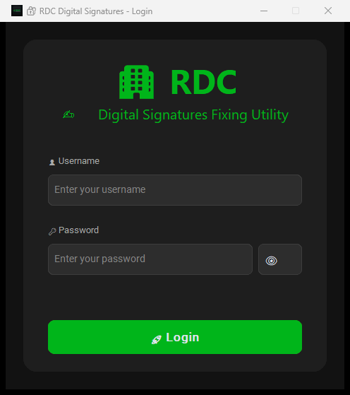
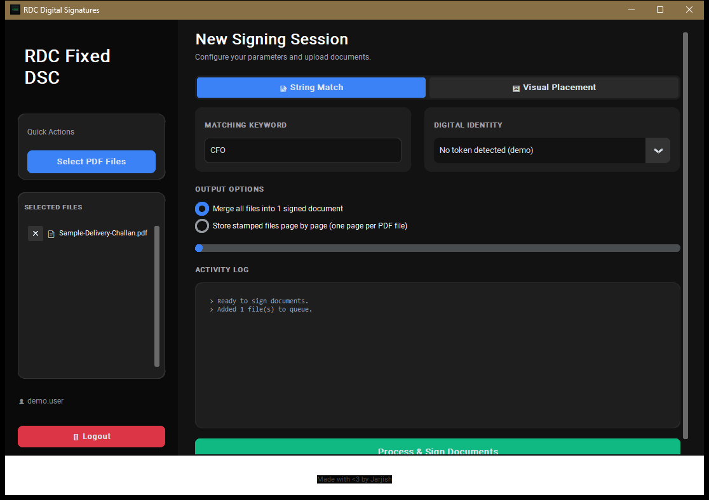
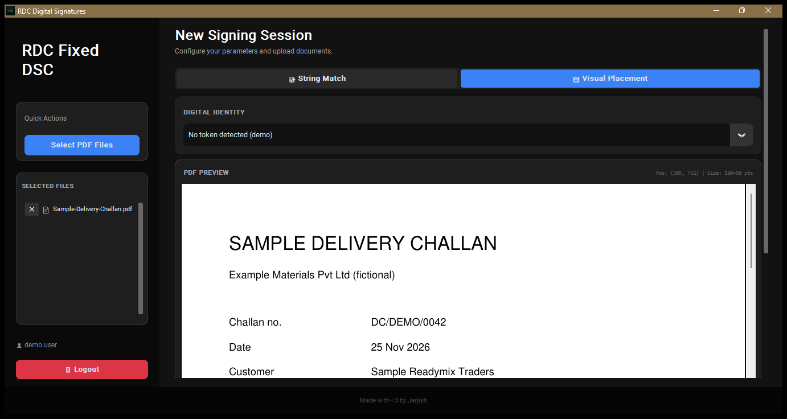
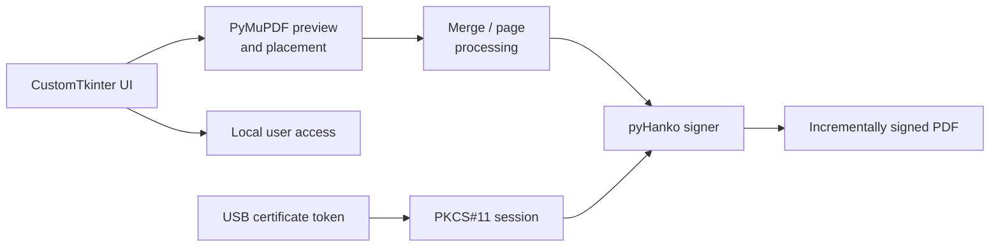

# RDC Digital Signatures

[](https://github.com/jarjishSiddibapa/rdc-digital-signatures/actions/workflows/ci.yml)
[](https://www.python.org/)
[](https://docs.oasis-open.org/pkcs11/)

A Windows desktop application for signing one PDF or a batch of PDFs with a hardware certificate token. It combines PDF analysis, visual signature placement, automated text-based placement, PKCS#11 certificate discovery, incremental PDF signing, and local user administration in one workflow.

The application was built to replace a paid per-user signing utility and reduce repetitive document handling. The public repository contains source, tests, build definitions, and documentation. Real documents, signed outputs, token PINs, user databases, certificates, private keys, and installer artifacts are excluded.

## Capabilities

| Area | What the application provides |
| --- | --- |
| Hardware signing | Discovers PKCS#11 devices and signs with certificates stored on USB tokens |
| Placement | Drag-and-resize visual placement plus text-based automatic placement where clear space is available |
| Batch processing | Processes multiple documents and supports multi-page PDF workflows |
| PDF integrity | Uses incremental signatures and cleans merged PDF structures before signing |
| Desktop UX | CustomTkinter interface with file queue, preview canvas, progress, logs, and token status |
| Local access | PBKDF2-hashed local users and an optional environment-configured administrator |
| Distribution | PyInstaller and Inno Setup definitions for a Windows installer |

## Screenshots

> Taken from a local run with a fictional PDF and a demo user, with no hardware token connected, so the certificate menu is empty and no real signature is shown.

| | |
|---|---|
|  **Sign-in** (local users, PBKDF2-hashed) |  **Text-based placement**: find a label such as a role/title and sign beside it |
|  **Visual placement**: preview the PDF and drag and resize the signature box | |

## Quick start

```powershell
git clone https://github.com/jarjishSiddibapa/rdc-digital-signatures.git
cd rdc-digital-signatures
python -m venv .venv
.\.venv\Scripts\Activate.ps1
pip install -r requirements.txt
python set_credentials.py
python main.py
```

Use `set_credentials.py` to create the first local user. To enable the master administrator for a launch session:

```powershell
$env:RDC_SIGNATURES_ADMIN_USERNAME = "admin"
$env:RDC_SIGNATURES_ADMIN_PASSWORD = "use-a-long-unique-password"
python main.py
```

The administrator password is read at runtime and is never stored in source or the packaged executable.

## Signing workflow

1. Select one or more PDFs.
2. Choose visual placement or search for a label such as a role/title.
3. Connect the hardware certificate token and select its certificate.
4. Enter the token PIN in the signing dialog.
5. Review the output location and process status.

The PIN remains in memory only for the active signing operation. Generated files are written outside the application installation directory so a normal Windows user can run the installed app.

## Architecture



See [Architecture](docs/ARCHITECTURE.md) for component boundaries and security decisions.

## Project structure

```text
main.py                 Desktop interface and workflow coordination
backend/analyzer.py     Text search and clear-space placement analysis
backend/pdf_processor.py PDF merge and structural cleanup
backend/signer.py       Token discovery and pyHanko signing
backend/auth.py         Local users and runtime administrator configuration
backend/login_dialog.py Login and user-management interface
tests/                  Synthetic PDF tests
RDCSignatures.spec      PyInstaller build definition
installer.iss           Inno Setup installer definition
```

## Build a Windows package

```powershell
build_installer.bat
```

The script creates a PyInstaller distribution and, when Inno Setup 6 is available, an installer. Build outputs stay ignored by Git.

## Validation

```powershell
python -m unittest discover -s tests -v
python -m compileall -q main.py backend tests
```

## Documentation

- [Architecture](docs/ARCHITECTURE.md)
- [Security policy](SECURITY.md)
- [Contributing](CONTRIBUTING.md)
